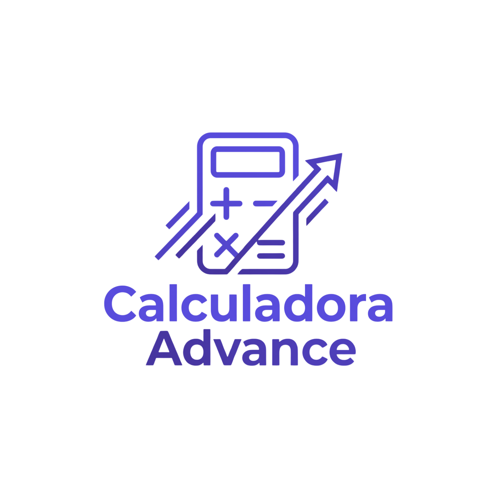

# Calculadora Solar Advance — Informe de Arquitectura y Funcionamiento



> **Documento técnico de referencia del proyecto · Versión 1.0**
> Estado del repositorio al cierre: rama `main`, todo commiteado y sincronizado con `origin` (último commit `5ce6db4`).

---

## Destinatarios

| Nombre | Rol | Nivel de lectura de este documento |
|---|---|---|
| **Bryan Bohorquez** | Experto en fórmulas · desarrollo técnico (usa Claude Code) | Lectura técnica completa + apartado «Prompt para Claude Code» (sección 11) |
| **Prema Mosquera** | Equipo | Resumen ejecutivo, visión, ventajas y mejoras (secciones 1, 2, 7, 8) |
| **Isabel Patiño** | Equipo | Resumen ejecutivo, visión, ventajas y mejoras (secciones 1, 2, 7, 8) |
| **Valentina Dominguez** | Equipo | Resumen ejecutivo, visión, ventajas y mejoras (secciones 1, 2, 7, 8) |

El documento íntegro está dirigido a **todo el equipo**. Solo la sección 11 (el *prompt* de arranque) está pensada específicamente para que **Bryan Bohorquez** se la entregue a su asistente de IA (Claude Code). Las secciones técnicas pueden leerse por encima sin perder el hilo: el resumen ejecutivo y las ventajas/mejoras están escritas para no ingenieros.

---

## 1. Resumen ejecutivo

La **Calculadora Solar Advance** es una aplicación web progresiva (PWA) que acompaña al libro *«Energía Solar Advance»*. No es una calculadora solar más: es el **compañero verificable del libro**. Reproduce los números exactos de sus dos casos de estudio (Torres y Los Alisos), enseña las 17 fórmulas del capítulo 31, añade herramientas profesionales de análisis financiero y técnico, y **certifica** al lector con un diploma que respalda su formación.

Características que la diferencian a nivel mundial:

1. **Es la sombra digital del libro**: la «verificación» demuestra, fórmula por fórmula, que la app devuelve los mismos resultados que la obra impresa. Eso genera confianza que ninguna calculadora genérica tiene.
2. **Localizada para Latinoamérica y España**: 22 países con moneda, bandera y documentos de identidad propios; los valores monetarios se muestran y editan en la moneda local.
3. **Offline de verdad**: funciona sin internet en zonas rurales — exactamente donde el libro pone el foco (los sistemas off-grid de la Parte VIII).
4. **Tres modos en un hub**: Educativo (aprender), Advance-Pro (trabajar) y Certificate (certificarse).
5. **Estética ultraglassmorphism premium**, con cero emojis: todos los iconos y banderas son SVG vectorial.

Está publicada en **GitHub Pages** (gratis, HTTPS) y se instala en el teléfono como una app nativa, sin pasar por las tiendas.

---

## 2. Visión y propósito

El libro se rige por el lema *«lo que no se puede documentar, no se promete»*. La calculadora encarna ese principio de tres maneras:

- **Matemática auditada**: cada resultado muestra su derivación completa (fórmula, valores sustituidos y resultado). La app «enseña el trabajo» en lugar de dar solo una respuesta.
- **Verificación contra el libro**: el modo verificación carga los casos Torres y Los Alisos y compara contra los valores de la obra, marcando «coincide» o «revisar».
- **Certificación con respaldo normativo**: el diploma se enmarca en el Decreto 1075 de 2015 y la Ley 115 de 1994 (Colombia), y en los estándares internacionales ISO/IEC 17024 e IEC 62446-1.

El propósito comercial: servir como herramienta de **venta** (el «Detective de facturas» y el «Simulador antes/después» convierten números en argumentos) y como **ancla de valor** del producto impreso.

---

## 3. Marco técnico general

### 3.1. Pila tecnológica

| Capa | Tecnología | Observación |
|---|---|---|
| Estructura | HTML5 semántico | Un único `index.html` como shell |
| Estilo | CSS3 (custom properties + BEM en español) | Glassmorphism, modo oscuro |
| Lógica | JavaScript vanilla (ES5, sin transpilar) | Sin frameworks, sin bundler, sin build step |
| Persistencia | `localStorage` + `IndexedDB` | Moneda, tema y proyectos guardados en el dispositivo |
| Voz | Web Speech API (`speechSynthesis`) | Lectura de fórmulas y resultados |
| Compartir | Web Share API + `navigator.clipboard` | Compartir por WhatsApp, etc. |
| Instalación | PWA (manifest + service worker) | `beforeinstallprompt` en Android, instrucciones en iOS |
| Hosting | GitHub Pages | Estático, HTTPS, gratuito |

### 3.2. Decisiones de arquitectura (y por qué)

- **Sin backend**: la app es 100 % estática. No hay servidor, ni base de datos, ni cuentas. Ventaja: costo cero, offline total, privacidad (los datos no salen del teléfono). Límite: no hay tipo de cambio en tiempo real ni verificación criptográfica por persona (ver sección 8).
- **JavaScript vanilla (ES5)**: máxima compatibilidad, cero dependencias de `node_modules`, y un código que cualquier asistente de IA (Copilot, Claude Code) puede leer y modificar sin fricción.
- **Un archivo = una responsabilidad**: cada módulo de JavaScript cumple una función clara (ver sección 4). Ningún archivo supera las ~600 líneas; si crece, se divide.
- **Enrutado por hash** (`#/...`): permite navegación profunda y URLs compartibles sin servidor (GitHub Pages no reescribe rutas).
- **Service worker versionado**: cada cambio que debe llegar al dispositivo instalado exige incrementar la constante `VERSION` (hoy `calc-advance-v9`).

### 3.3. Entorno de desarrollo

- Sistema operativo: Windows (con OneDrive sincronizando la carpeta del proyecto).
- No requiere Node.js ni instalación de dependencias para funcionar: basta un servidor estático local (ver sección 11).
- Para publicar: `git push` a `main` → GitHub Pages se actualiza en menos de un minuto.

---

## 4. Estructura del repositorio

```
calculadora_advance/
├── index.html              # Shell de la SPA: cabecera, contenedor, tabbar, overlays
├── manifest.json           # PWA: nombre, iconos, tema, orientación
├── service-worker.js       # Offline + actualización automática (VERSION = v9)
├── logo_advance.png        # Logotipo de la calculadora (fuente de los iconos)
├── css/
│   └── app.css             # TODO el estilo (glassmorphism, tokens, modo oscuro)
├── js/
│   ├── formulas.js         # 17 fórmulas del capítulo 31 + presets de verificación
│   ├── herramientas-pro.js # 10 herramientas profesionales
│   ├── localizacion.js     # HSP por ciudad + tarifas por país (orientativo)
│   ├── banderas.js         # 22 banderas SVG de los países de la conversión
│   ├── almacen.js          # Persistencia de proyectos (IndexedDB)
│   ├── venta.js            # Asesor de decisión, simulador y detective de facturas
│   ├── examen.js           # Certificación: formulario, 20 preguntas, diploma, verificación
│   └── app.js              # Orquestador: hub, enrutado, moneda, tema, utilidades
└── iconos/
    ├── icon-192.png        # Icono PWA 192x192
    ├── icon-512.png        # Icono PWA 512x512 (+ maskable)
    ├── apple-touch-icon.png# Icono iOS
    └── favicon-32.png      # Favicon
```

### 4.1. Responsabilidad de cada archivo JavaScript

| Archivo | Exposición global | Responsabilidad |
|---|---|---|
| `formulas.js` | `window.FORMULAS`, `window.PRESETS` | Datos de las 17 fórmulas (entradas + cálculo puro) y los dos presets de verificación |
| `herramientas-pro.js` | `window.HERRAMIENTAS_PRO` | Datos de las 10 herramientas profesionales |
| `localizacion.js` | `window.CIUDADES`, `window.TARIFAS` | HSP orientativo por ciudad y tarifas por país |
| `banderas.js` | `window.BANDERAS`, `window.banderaSVG()` | SVG de las 22 banderas |
| `almacen.js` | `window.Almacen` | Guardar/listar/borrar/restaurar proyectos en IndexedDB |
| `venta.js` | `window.Venta` | Tres herramientas de venta interactivas |
| `examen.js` | `window.montarCertificado()`, `window.mostrarVerificacion()` | Flujo de certificación y pantalla de verificación |
| `app.js` | (IIFE autocontenida) | Orquesta todo: hub, enrutado por hash, selector de moneda, tema, utilidades por tarjeta |

El orden de carga en `index.html` es el indicado: los archivos de **datos** (`formulas`, `herramientas-pro`, `localizacion`, `banderas`) se cargan antes que `app.js`, que los consume. `almacen`, `venta` y `examen` exponen funciones que `app.js` invoca.

---

## 5. Ingeniería: los tres modos

### 5.1. Hub (pantalla de entrada)

Tres tarjetas grandes con iconos SVG: **Educativo**, **Advance · Pro** y **Certificate**. Cada una navega a su ruta de hash. Una **casita** en la cabecera regresa al hub desde cualquier punto.

### 5.2. Modo Educativo (17 fórmulas + verificación)

Cinco módulos accesibles por la barra de pestañas inferior (estilo red social) más una pestaña «Verificar»:

| Módulo | Fórmulas |
|---|---|
| 1 · Factura | 1. Consumo diario · 2. Gasto proyectado a 10 años · 3. Ahorro real con cargos fijos |
| 2 · Dimensión | 4. Producción útil mensual · 5. Potencia pico necesaria · 6. Número de paneles · 7. Cobertura |
| 3 · Economía | 8. Ahorro mensual · 9. Payback · 10. LCOE |
| 4 · Autónomo | 11. Banco útil · 12. Banco nominal · 13. LCOE de la isla |
| 5 · Técnico | 14. Voc en frío · 15. Protecciones · 16. Calibre por caída de tensión · 17. Generador de respaldo |

Cada fórmula es un **objeto con una estructura estable** (el contrato de datos, no la fórmula en sí):

```js
{
  id, modulo, nombre, expresion, unidad,
  inputs: [ { clave, etiqueta, unidad, defecto } ],
  calculo: function (v) { ... },   // función PURA: entra un objeto, sale un número
  formato: function (n) { ... },   // presentación del resultado
  nota?, orientativo?              // opcionales
}
```

Separación de roles: **las fórmulas SÍ pueden modificarse** — su revisión, corrección y mejora corresponde al experto en fórmulas del equipo (Bryan Bohorquez). Lo que edita el **usuario final** son las variables de contexto del país (PR, HSP, tarifa, inflación, DOD, coeficiente térmico, etc.), sin necesidad de tocar la fórmula. El PR por defecto es **0,80** (el valor del libro) pero editable; la HSP por defecto es **4,2** marcada «orientativo — verificar en PVGIS». Regla de coherencia: si se modifica una fórmula, debe actualizarse también su preset de verificación para que la app siga reproduciendo los números del libro.

**Modo verificación**: dos botones (Caso Torres, Caso Los Alisos) cargan los valores del libro y comparan el cálculo contra los resultados impresos, con tolerancias definidas por fórmula. Ejemplo real: Caso Torres → 4 paneles, 181 kWh/mes, 27,2 USD/mes, 7,1 años, 0,055 USD/kWh. Caso Los Alisos → 2 paneles, 8,1 kWh, 44,8 V, 0,38 USD/kWh.

Nota técnica honesta: el LCOE de la isla (fórmula 13) da ~0,34 con los insumos del libro, que redondea a 0,38; la app lo documenta con una nota y una tolerancia de 0,03.

### 5.3. Modo Advance · Pro

Dos bloques:

**Herramientas de venta** (3 tarjetas interactivas):
- **Asesor de decisión**: tres preguntas guiadas que recomiendan on-grid, híbrido u off-grid siguiendo la lógica de la Parte VIII.
- **Simulador antes/después**: gráfico SVG año a año («sin solar» crece con la inflación de la tarifa, «con solar» suma CAPEX + residuo) con el punto exacto de payback.
- **Detective de facturas**: reconstruye las 5 zonas del capítulo 2 (consumo, energía, cargos fijos, impuestos/subsidios, total) y detecta anomalías (cargos fijos > 40 %, tarifa alta, carga impositiva > 20 %).

**Herramientas de cálculo** (10, cada una con su botón «?» que explica para qué sirve):

| # | Herramienta | Expresión | Unidad |
|---|---|---|---|
| p1 | Temperatura de celda | Tamb + (NOCT−20)÷800×G | °C |
| p2 | Pérdida por temperatura | Pmp×[1+γ×(Tcelda−25)] | W |
| p3 | Producción con degradación | E0×(1−d)^n | kWh/año |
| p4 | Performance ratio real | E÷(H×P_STC) | ratio |
| p5 | Factor de planta | E÷(P_STC×8760) | % |
| p6 | VAN del proyecto | −CAPEX+Σahorro÷(1+r)^t | USD |
| p7 | TIR del proyecto | r tal que VPN(r)=0 | %/año |
| p8 | Ventana MPPT del inversor | N máx por Voc frío · N mín por Vmp calor | módulos/serie |
| p9 | Separación entre filas | h÷tan(elevación mínima) | m |
| p10 | CO₂ evitadas | E×factor de emisión | kg/año |

### 5.4. Modo Certificate

Flujo completo:

1. **Formulario de identidad**: país, tipo de documento oficial (por país — cédula, DNI, RUN, INE, DPI… — más Pasaporte y Carnet de extranjería siempre disponibles), número, nombres y apellidos. Botón «Iniciar examen».
2. **Examen**: 20 preguntas de selección múltiple, una por pantalla con barra de progreso. Cada acierto vale 4 puntos (máximo 80). Se aprueba con **80 %** (16 aciertos).
3. **Resultado**: si aprueba → diploma (con descarga automática por impresión). Si no → botón «Intentar de nuevo».
4. **Diploma**: *«Analista de Sistemas Fotovoltaicos — Multienfoque»*, emitido por **Energía Solar Surya S.A.S. CO** y **Proyecto Lazarus 420**, con nombre, documento, fecha, firma y respaldo normativo (Decreto 1075/2015, Ley 115/1994, ISO/IEC 17024, IEC 62446-1).
5. **QR de verificación**: apunta a una pantalla estática que muestra titular, documento, fecha, programa y entidades emisoras. (Limitación documentada en la sección 8.3.)

---

## 6. Ingeniería: moneda y localización

### 6.1. Conversión de moneda

- **22 países**: Estados Unidos (referencia), México, Guatemala, El Salvador, Honduras, Nicaragua, Costa Rica, Panamá, Cuba, República Dominicana, Puerto Rico, Colombia, Venezuela, Ecuador, Perú, Bolivia, Chile, Paraguay, Uruguay, Argentina, Brasil y España.
- **Tipo de cambio orientativo y editable**: cada país trae una tasa de referencia aproximada que el usuario puede ajustar.
- **Localización completa de entradas**: los campos monetarios se muestran y editan en la moneda local; internamente la app convierte local→USD para calcular y USD→local para mostrar. Así las fórmulas siguen calculando en la moneda del libro y la verificación no se rompe.
- **Persistencia**: la elección de moneda se guarda en `localStorage` y se restaura al reabrir.
- **Banderas**: 22 banderas SVG dibujadas a mano (sin emojis) en un menú desplegable personalizado.

### 6.2. Localización por ciudad

El módulo Dimensión incluye una tarjeta «Ubicación de referencia» con 20 ciudades (HSP orientativo) que rellenan las fórmulas 4 y 5. Todas marcadas «orientativo — verificar en PVGIS», fiel al Anexo B del libro.

---

## 7. Diseño

### 7.1. Lenguaje visual

- **Ultraglassmorphism**: paneles de vidrio translúcido (`backdrop-filter: blur`), gradientes sutiles, bordes claros de 1 px y sombras suaves. Fondo azul profundo con resplandor dorado.
- **Paleta oficial** (tokens en `:root` de `app.css`):

| Token | Valor | Uso |
|---|---|---|
| Azul profundo | `#12375B` / `#0E2B47` | Cabecera, gradientes, títulos |
| Dorado | `#C2A042` / `#D3B253` | Acentos, botones primarios, flechas |
| Tinta / tinta suave | variables `--tinta`, `--tinta-suave` | Texto principal y secundario |

- **Cero emojis**: iconos y banderas son SVG inline (vectorial). Regla innegociable en todo el proyecto.
- **BEM en español**: `.tarjeta__cabecera`, `.campo__entrada`, `.fila-verificacion__concepto`, etc.
- **Modo oscuro**: tema glassmorphism oscuro, conmutado por la luna de la cabecera y persistido.

### 7.2. Cabecera

De izquierda a derecha: logo + título/subtítulo; en la esquina superior derecha, una columna con (arriba) la **casita** y la **luna** lado a lado, y (debajo) el **selector de moneda** con su bandera y el campo de tipo de cambio cuando corresponde.

---

## 8. Ventajas del modelo actual

1. **Costo de infraestructura cero**: GitHub Pages es gratuito; no hay servidor que mantener ni factura mensual.
2. **Cero dependencias de runtime**: sin `node_modules`, sin build, sin riesgo de «se rompió una dependencia». El código funciona tal cual se publica.
3. **Offline real**: el service worker precachea toda la app. Ideal para zonas rurales con mala conectividad — el corazón del libro.
4. **Privacidad por diseño**: moneda, tema y proyectos viven en el dispositivo (localStorage/IndexedDB); nada se envía a un servidor.
5. **Instalación sin tiendas**: se instala en Android e iOS desde el navegador, evitando la revisión y los costos de las tiendas.
6. **Fácil de mantener y de delegar a IA**: JavaScript vanilla, funciones puras y un archivo por responsabilidad. Cualquier asistente (Copilot, Claude Code) puede asistir sin fricción.
7. **Actualización automática**: el service worker versionado renueva la app instalada en cada apertura con conexión.
8. **Fidelidad al producto**: la verificación contra el libro es un argumento de venta y de confianza único.

---

## 9. Oportunidades de mejora (dentro de los límites del entorno)

### 9.1. Técnicas

- **Refactor a ES Modules**: hoy los módulos exponen objetos en `window`; migrar a `import`/`export` mejoraría el aislamiento (sin cambiar la compatibilidad).
- **Pruebas unitarias de las funciones puras**: `formulas.js` y `herramientas-pro.js` son ideales para tests (cada `calculo` es determinista). Un runner ligero (sin build) bastaría.
- **Accesibilidad**: auditar roles ARIA, foco de teclado, contraste en modo oscuro y `prefers-reduced-motion`.
- **Persistencia de proyectos en USD**: hoy los proyectos se guardan tal cual se ven (en moneda local); guardarlos en USD y convertir al abrir los haría robustos ante cambios de moneda.
- **Más países/ciudades**: ampliar `localizacion.js` y `banderas.js` es trivial (añadir un objeto y un SVG).
- **Límite de preguntas del examen**: un banco mayor a 20 con sorteo aleatorio aumentaría la credibilidad del certificado (fue descartado por decisión del director, pero es una extensión natural).

### 9.2. Visuales y de diseño

- **Microanimaciones**: transiciones al cambiar de modo, al abrir el selector de moneda, al marcar «coincide» en la verificación.
- **Banderas con más detalle**: hoy son simplificadas (colores y disposición). Podrían añadirse el águila de México, el sol de Argentina, las estrellas de Venezuela, etc., sin salir de SVG.
- **Curva del simulador con más datos**: ejes rotulados, tooltip al pasar el dedo, comparativa de dos escenarios.
- **Modo oscuro más profundo**: revisar los componentes que aún usan fondo claro fijo (opciones, tarjetas del certificado).
- **Tipografía dedicada**: hoy usa fuentes del sistema; vendar una fuente serif editorial (como Source Serif o Literata) con su licencia OFL elevaría la percepción premium.

### 9.3. Límites del entorno (qué NO se puede sin salir de la PWA estática)

1. **Tipo de cambio en tiempo real**: hoy es una tasa editable y orientativa. Para FX en vivo se necesitaría un backend o un servicio externo (rompe el offline).
2. **Verificación criptográfica real del diploma**: la pantalla de verificación es estática (muestra los datos del QR). Firmar y verificar por persona requiere servidor.
3. **Sincronización en la nube / cuentas**: sin backend no hay nube; los proyectos son por dispositivo.
4. **Escalado a lógica de negocio (pagos, usuarios, analíticas)**: todo eso exige salir del modelo estático.

Ruta recomendada si el libro despega: añadir un backend mínimo (Cloudflare Worker o Firebase) **sin reescribir la app**, solo para FX en vivo, verificación firme y cuentas.

---

## 10. Guía rápida de funcionamiento

- **Abrir**: `https://bryan6621.github.io/energia-solar-advance-calculadora/` o escanear el QR del libro.
- **Instalar (Android)**: tocar «Instalar app» → queda en el inicio. **Instalar (iPhone)**: Safari → Compartir → «Agregar a pantalla de inicio».
- **Navegar**: hub → modo → pestañas. La casita regresa al hub; la luna cambia el tema.
- **Moneda**: selector en la esquina superior derecha (con bandera).
- **En cada fórmula**: «=» muestra la derivación · altavoz lee en voz alta · flecha compartir comparte el resultado.
- **Guardar proyecto**: bloque «Tus proyectos» → «Guardar proyecto» (modal) → «Abrir» para retomarlo.
- **Actualizar**: la app instalada se renueva sola; en navegador, recargar (o forzar con recarga de caché).

---

## 11. Instrucciones para Bryan Bohorquez + Prompt para Claude Code

### 11.1. Contexto para ti

El repositorio está en `main`, sincronizado y sin cambios pendientes. URL de producción: `https://bryan6621.github.io/energia-solar-advance-calculadora/`. El proyecto **no usa Node.js ni build**: es una PWA estática. Para trabajar localmente solo necesitas un servidor estático y un navegador.

Reglas que debes respetar en cualquier mejora:

1. **Cero emojis**: solo SVG vectorial.
2. **JavaScript vanilla ES5** (sin frameworks, sin bundler, sin `node_modules`).
3. **Español** en todo el texto de interfaz y comentarios.
4. **Un archivo = una responsabilidad**; si un archivo supera ~600 líneas, divídelo.
5. **Las fórmulas sí se pueden modificar**: eres el experto en fórmulas del equipo; revisarlas, corregirlas o mejorarlas es parte de tu rol. Cuida la coherencia: si cambias una fórmula, actualiza su preset de verificación y documéntalo en el commit.
6. **Al publicar, incrementa `VERSION` en `service-worker.js`** para que la app instalada se actualice.
7. **Commits en español**, mensajes descriptivos, rama `main`.

### 11.2. Prompt para Claude Code (copia y pega tal cual)

```text
Estás trabajando en la PWA «Calculadora Solar Advance», el compañero digital del libro
«Energía Solar Advance». Es una aplicación estática (HTML + CSS + JavaScript vanilla ES5,
sin frameworks, sin build, sin Node.js), alojada en GitHub Pages.

REPOSITORIO
- git clone https://github.com/Bryan6621/energia-solar-advance-calculadora.git
- Rama: main. Todo está commiteado y sincronizado.

CÓMO EJECUTAR EN LOCAL
No requiere instalación de dependencias. Solo un servidor estático sobre la carpeta clonada:
- Opción A (Python):  python -m http.server 8090
- Opción B (Node/npx): npx serve .
Luego abre http://localhost:8090 en el navegador.
Nota: las funciones de PWA (instalación, service worker) requieren localhost o HTTPS; en localhost funcionan.

ESTRUCTURA (leer antes de tocar)
- index.html        shell de la SPA (cabecera, contenedor, tabbar, overlays)
- manifest.json     PWA
- service-worker.js offline + auto-actualización (constante VERSION)
- css/app.css       TODO el estilo (glassmorphism, tokens, modo oscuro)
- js/formulas.js    17 fórmulas del libro + presets de verificación (window.FORMULAS, window.PRESETS)
- js/herramientas-pro.js  10 herramientas profesionales (window.HERRAMIENTAS_PRO)
- js/localizacion.js  HSP por ciudad + tarifas por país (window.CIUDADES, window.TARIFAS)
- js/banderas.js      22 banderas SVG (window.BANDERAS, window.banderaSVG)
- js/almacen.js       proyectos en IndexedDB (window.Almacen)
- js/venta.js         asesor, simulador, detective (window.Venta)
- js/examen.js        certificación: formulario, 20 preguntas, diploma, verificación
- js/app.js           orquestador: hub, enrutado por hash, moneda, tema, utilidades

CONVENCIONES INNEGOCIABLES
1. Cero emojis: todo icono, bandera o símbolo es SVG inline.
2. JavaScript vanilla ES5 (function(){}), sin transpilar, sin dependencias.
3. Textos y comentarios en español neutro.
4. BEM en español (.tarjeta__cabecera, .campo__entrada, .fila-verificacion__concepto).
5. Un archivo = una responsabilidad. No superes ~600 líneas por archivo.
6. Las funciones de cálculo (calculo en formulas.js y herramientas-pro.js) son PURAS
   (deterministas, sin efectos secundarios). Puedes modificarlas y mejorarlas: eres el experto
   en fórmulas del equipo. Regla de coherencia: si cambias una fórmula, actualiza también su
   preset de verificación (window.PRESETS) para que el modo «Verificar» siga reproduciendo los
   números del libro, y documéntalo en el mensaje del commit.
7. La moneda funciona así: los campos monetarios se muestran/editan en moneda local; la app
   convierte local→USD al calcular y USD→local al mostrar. Preserva siempre este invariante.
8. El enrutado es por hash (#/, #/educativo, #/pro, #/certificado, #/asesor, #/simulador,
   #/detective, #/verificar). No rompas las URLs existentes.

FLUJO DE TRABAJO PARA CADA CAMBIO
1. Haz los cambios en el archivo correspondiente.
2. Incrementa la constante VERSION en service-worker.js (ej. de calc-advance-v9 a v10).
3. Verifica en local (http://localhost:8090) que no haya errores de consola.
4. Commit en español con mensaje descriptivo y push a main:
   git add -A
   git commit -m "Descripción breve de lo que cambia"
   git push origin main
5. GitHub Pages se actualiza solo en menos de un minuto.

ANTES DE EMPEZAR
Confírmame que entiendes la estructura y las convenciones, y dime qué mejora vas a abordar
primero. Si tienes dudas sobre un archivo, léelo completo antes de editarlo.
```

---

## 12. Estado de entrega y trazabilidad

- **Repositorio**: `github.com/Bryan6621/energia-solar-advance-calculadora` (público, rama `main`).
- **Producción**: `https://bryan6621.github.io/energia-solar-advance-calculadora/`.
- **Service worker**: `calc-advance-v9`.
- **Commits recientes** (los 8 últimos):

```
5ce6db4  Banderas SVG de cada país en el selector de moneda (menú desplegable personalizado)
430042b  Guardar proyecto: signo de interrogación explicativo y modal estilizado (sin URL del navegador)
a7e0e89  Forzar recarga limpia de la cabecera (v7): casita y luna lado a lado encima de la moneda
8ecdc61  Localización completa de moneda: los campos monetarios muestran y editan en moneda local, y la elección de moneda se recuerda
1d6bbd2  Cabecera: casita y luna en la misma línea, encima del selector de moneda (esquina superior derecha)
12a0b70  Fases 2-5: asesor de decisión, simulador antes/después (SVG), detective de facturas y guardar/abrir proyectos (IndexedDB)
066cf4a  Fase 1: modo oscuro, matemática auditada (derivación), lector de voz, compartir cálculo y localización por ciudad (HSP orientativo)
73b804d  Botón de casita (SVG) en la cabecera para regresar al hub desde cualquier modo
```

- **Sin cambios pendientes**: `git status` limpio; `main` sincronizada con `origin/main`.

---

*Documento generado por el agente de ingeniería Docs-as-Code del proyecto «Energía Solar Advance». Nota de uso: la imagen `logo_advance.png` debe acompañar a este archivo `.md` si se comparte fuera del repositorio.*
